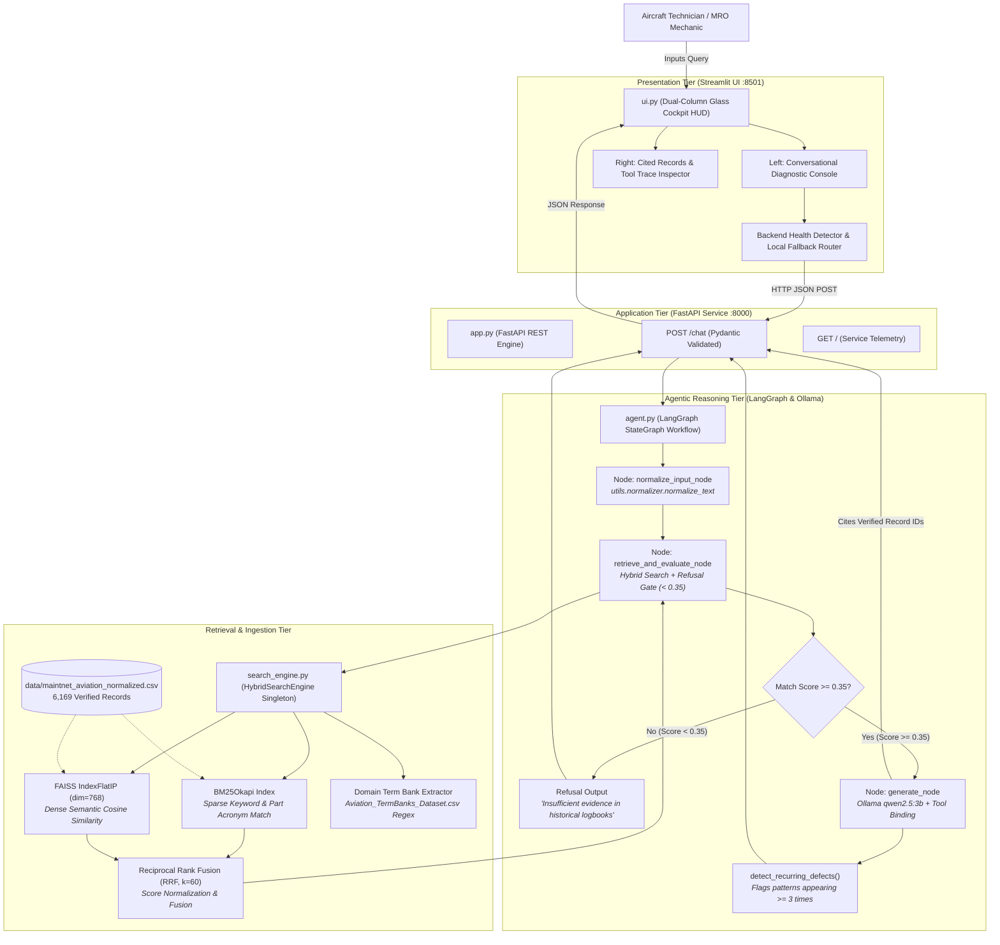
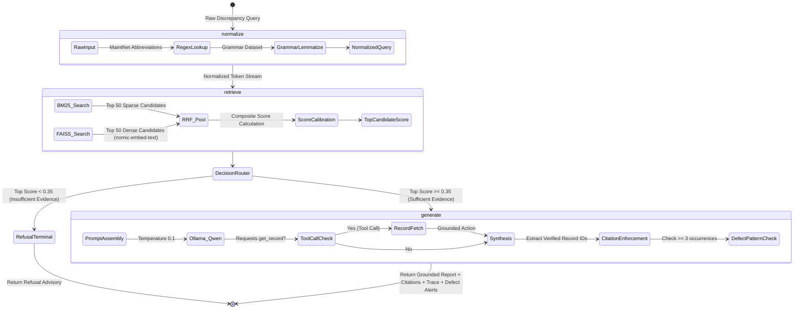

# Aviation Maintenance Copilot // Agentic RAG Diagnostic Assistant

> **Enterprise Agentic Retrieval-Augmented Generation (RAG) Architecture for Aircraft MRO Logbooks Grounded in 6,169 MaintNet Historical Maintenance Records**

[](https://www.python.org/downloads/)
[](https://fastapi.tiangolo.com)
[](https://streamlit.io/)
[](https://github.com/langchain-ai/langgraph)
[](https://github.com/facebookresearch/faiss)
[](https://github.com/dorianbrown/rank_bm25)
[]()
[-brightgreen.svg)]()
[-purple.svg)](https://ollama.com/)
[](LICENSE)

---

> [!NOTE]
> **Repository Lineage & Fork Attribution**  
> • **Upstream Source Repository:** [shyam-shankar/Aviation_Maintanence_Copilot-NexAIHack](https://github.com/shyam-shankar/Aviation_Maintanence_Copilot-NexAIHack)  
> • **Current Project:** [keshavjayaprakash2006-hash/Aviation-Maintenance-Copilot](https://github.com/keshavjayaprakash2006-hash/Aviation-Maintenance-Copilot)  
> • **Local Execution Enhancement:** Cloud API key requirements (Google Gemini/Cloud LLM) have been removed. The assistant runs **100% locally on localhost** using Ollama (`mistral:latest` / `qwen2.5:3b` + `nomic-embed-text`) for zero-cost, privacy-preserving MRO logbook inference.

---

> [!WARNING]
> **MANDATORY FLIGHT SAFETY & AIRWORTHINESS ADVISORY**  
> This copilot provides diagnostic reference based strictly on historical logbook entries from the MaintNet aviation maintenance dataset (University of North Dakota Department of Aviation). It does **not** provide FAA/EASA certified or manufacturer-approved maintenance procedures. Aviation maintenance technicians and certificated A&P mechanics must **always consult the official Aircraft Maintenance Manual (AMM), Illustrated Parts Catalog (IPC), and applicable Airworthiness Directives (ADs)** before performing maintenance or signing off an aircraft return-to-service.

---

## Table of Contents

- [1. Executive Summary](#1-executive-summary)
- [2. The Problem Space & The Aviation Challenge](#2-the-problem-space--the-aviation-challenge)
  - [The "Garbage In, Garbage Out" Logbook Dilemma](#the-garbage-in-garbage-out-logbook-dilemma)
  - [Why Standard Vector RAG Fails in Aviation MRO](#why-standard-vector-rag-fails-in-aviation-mro)
- [3. End-to-End System Architecture](#3-end-to-end-system-architecture)
  - [Two-Tier Microservice Pipeline](#two-tier-microservice-pipeline)
  - [LangGraph Agentic Decision State Machine](#langgraph-agentic-decision-state-machine)
- [4. Deep-Dive: Architectural Decisions & Technical Rationale](#4-deep-dive-architectural-decisions--technical-rationale)
  - [Decision 1: Decoupled Two-Tier Microservice Architecture (FastAPI + Streamlit)](#decision-1-decoupled-two-tier-microservice-architecture-fastapi--streamlit)
  - [Decision 2: Domain Abbreviation & Grammar Normalization Ingestion Pipeline](#decision-2-domain-abbreviation--grammar-normalization-ingestion-pipeline)
  - [Decision 3: Hybrid Retrieval (BM25 + FAISS Dense Embeddings) with Reciprocal Rank Fusion (RRF)](#decision-3-hybrid-retrieval-bm25--faiss-dense-embeddings-with-reciprocal-rank-fusion-rrf)
  - [Decision 4: Technical Entity Extraction via Compiled Domain Term Bank](#decision-4-technical-entity-extraction-via-compiled-domain-term-bank)
  - [Decision 5: LangGraph StateGraph Orchestration with Strict Refusal Gating (< 0.35)](#decision-5-langgraph-stategraph-orchestration-with-strict-refusal-gating--035)
  - [Decision 6: Explicit Verifiable Record ID Citations (`[Record #XXXXXX]`)](#decision-6-explicit-verifiable-record-id-citations-record-xxxxxx)
  - [Decision 7: Fully Localized Privacy-Preserving Inference via Ollama](#decision-7-fully-localized-privacy-preserving-inference-via-ollama)
  - [Decision 8: Fleet Recurring Defect Detector Module](#decision-8-fleet-recurring-defect-detector-module)
- [5. Automated Evaluation & Empirical Benchmark Suite](#5-automated-evaluation--empirical-benchmark-suite)
  - [Executive Benchmark Summary](#executive-benchmark-summary)
  - [Retrieval Modality Comparison (BM25 vs. FAISS vs. Hybrid RRF)](#retrieval-modality-comparison-bm25-vs-faiss-vs-hybrid-rrf)
  - [Refusal Gate Safety Performance (Confusion Matrix)](#refusal-gate-safety-performance-confusion-matrix)
- [6. Component-by-Component Implementation Breakdown](#6-component-by-component-implementation-breakdown)
  - [Data Ingestion Pipeline (`preprocess.py`)](#data-ingestion-pipeline-preprocesspy)
  - [Text Normalizer (`utils/normalizer.py`)](#text-normalizer-utilsnormalizerpy)
  - [Hybrid Search Engine (`search_engine.py`)](#hybrid-search-engine-search_enginepy)
  - [Agentic Backend (`agent.py`)](#agentic-backend-agentpy)
  - [FastAPI Microservice (`app.py`)](#fastapi-microservice-apppy)
  - [Streamlit Glass Cockpit UI (`ui.py`)](#streamlit-glass-cockpit-ui-uipy)
  - [Automated Evaluation Suite (`evaluate.py`)](#automated-evaluation-suite-evaluatepy)
- [7. Branch Architecture: `main` vs. `graph_test`](#7-branch-architecture-main-vs-graph_test)
- [8. Repository Structure](#8-repository-structure)
- [9. Installation & Quickstart](#9-installation--quickstart)
  - [Prerequisites](#prerequisites)
  - [Environment Setup](#environment-setup)
  - [Running the Services](#running-the-services)
  - [Running the Automated Evaluation Suite](#running-the-automated-evaluation-suite)
  - [Testing Sample Queries & Refusal Gate](#testing-sample-queries--refusal-gate)
- [10. Attribution & License](#10-attribution--license)

---

## 1. Executive Summary

**Aviation Maintenance Copilot** is an enterprise agentic diagnostic assistant designed specifically for aircraft maintenance, repair, and overhaul (MRO) technicians. Operating across **6,169 verified historical logbook records** from the MaintNet aviation maintenance dataset (University of North Dakota Department of Aviation), the copilot translates terse, abbreviated pilot squelches and discrepancy reports (e.g., `ENG OIL PRESS LOW`, `ACFT HYD SYS A LEAK REPL PUMP`, `CYL HEAD TEMP HIGH INOP`) into grounded, verifiable corrective maintenance procedures.

The system is architected as a **two-tier decoupled microservice**:
1. **FastAPI Asynchronous REST API ([`app.py`](app.py)):** Exposes high-throughput endpoints (`POST /chat`, `GET /`) for diagnostic querying and automated health telemetry.
2. **Streamlit Glass Cockpit Frontend ([`ui.py`](ui.py)):** A dual-column technician interface providing chat diagnostics, side-by-side historical logbook evidence cards, domain entity badges, recurring fleet defect alerts, and an auditable step-by-step tool execution trace.

Built strictly for safety-critical aviation environments where hallucinations cannot be tolerated, the copilot executes a **LangGraph StateGraph workflow** governed by a **strict mathematical refusal gate (threshold $< 0.35$)**. Queries without sufficient empirical backing in past logbooks are rejected with an explicit refusal advisory, preventing ungrounded procedure fabrication.

---

## 2. The Problem Space & The Aviation Challenge

### The "Garbage In, Garbage Out" Logbook Dilemma

Aircraft maintenance records are composed under operational flight line pressure using non-standardized shorthand:
- **Telegraphic Acronyms:** `ACFT` (aircraft), `HYD` (hydraulic), `PRESS` (pressure), `INSP` (inspection), `ENG` (engine), `REPL` (replaced), `CHK` (checked), `ALT` (alternator), `SYS` (system), `INOP` (inoperative), `R&R` (removed and replaced).
- **Phonetic Variations & Concatenations:** Technicians frequently misspell part names or concatenate words without spaces (`powerloss`, `stopdrilled`).
- **Syntactic Truncation:** Complete sentences are omitted in favor of fragment logs (e.g., `L/H MAGNETO HAD DROP OF 300 RPM ON RUN UP. LEANED MIXTURE. CHK OK`).

Off-the-shelf NLP tokenizers (WordNet, spaCy) treat these abbreviations as noise or punctuation, while generic embedding models produce degraded representations.

### Why Standard Vector RAG Fails in Aviation MRO

1. **Semantic Vector Drift on Hardware Part Numbers:** Dense vector embeddings (e.g., standard Sentence-BERT or OpenAI text-embedding) map texts into continuous vector spaces based on general semantic context. In aviation, this causes near-miss failure modes or completely different hardware components (e.g., `MAGNETO` vs. `ALTERNATOR`) to cluster together because both share the general context of "engine electrical system". A pure vector search frequently returns irrelevant parts with misleadingly high cosine similarity.
2. **Loss of Exact Part Identification:** Maintenance procedures depend on exact alphanumeric part designations, valve numbers, and assembly names. Vector embeddings compress this fine-grained syntactic detail, resulting in poor retrieval for specific part queries.
3. **Hallucination Under Uncertainty:** Standard generative LLMs are pre-trained to be conversational and helpful. When faced with an unfamiliar fault or out-of-domain query, standard RAG pipelines feed the nearest retrieved chunk to the LLM, which fabricates plausible-sounding but unverified torque specs, pressures, or repair steps—posing extreme airworthiness risks.

---

## 3. End-to-End System Architecture

### Two-Tier Microservice Pipeline



---

### LangGraph Agentic Decision State Machine

The diagnostic reasoning loop is governed by an explicit `StateGraph`:



---

## 4. Deep-Dive: Architectural Decisions & Technical Rationale

### Decision 1: Decoupled Two-Tier Microservice Architecture (FastAPI + Streamlit)

* **Implementation:** [`app.py`](app.py) & [`ui.py`](ui.py)
* **What it does:**
  - Separates backend business logic and agent execution into an asynchronous REST service built on **FastAPI** (`POST /chat`, `GET /`), running on port 8000.
  - Houses the user interface in a dedicated **Streamlit** application (`ui.py`), running on port 8501.
  - Implements **automatic local fallback**: if the FastAPI server is offline, `ui.py` detects the connection failure and invokes [`agent.run_agent()`](agent.py#L311) directly in-process.
* **Why this decision was made:**
  - **Enterprise Integration & Extensibility:** MRO facilities use a variety of client devices (electronic flight bags, ruggedized hangar tablets, barcode scanners, and inventory ERP systems). A REST API allows external systems to query maintenance intelligence programmatically without binding to Streamlit.
  - **Independent Scalability:** The heavy computational workload (FAISS search, embedding generation, LLM inference) can be hosted on dedicated on-premise compute servers while lightweight frontends run locally.
  - **Graceful Fault Tolerance:** The fallback logic in `ui.py` ensures mechanics are never blocked if the web service container is rebooted.

---

### Decision 2: Domain Abbreviation & Grammar Normalization Ingestion Pipeline

* **Implementation:** [`preprocess.py`](preprocess.py) & [`utils/normalizer.py`](utils/normalizer.py)
* **What it does:**
  - Loads dynamic MaintNet datasets: `Aviation_Abbreviation_Dataset.csv` and `Aviation_grammar_Dataset.csv`.
  - Merges dynamic dictionaries with operational baseline aviation maintenance shorthand:
    - `acft` $\rightarrow$ `aircraft`
    - `hyd` $\rightarrow$ `hydraulic`
    - `press` $\rightarrow$ `pressure`
    - `insp` $\rightarrow$ `inspection`
    - `eng` $\rightarrow$ `engine`
    - `repl` $\rightarrow$ `replaced`
    - `chk` $\rightarrow$ `checked`
    - `alt` $\rightarrow$ `alternator`
    - `sys` $\rightarrow$ `system`
  - Ingestion pipeline [`preprocess.py`](preprocess.py) parses raw `maintnet_aviation.csv` (6,169 records), applies normalization to `PROBLEM` and `ACTION` columns, formats a unified structured field `COMBINED_NORMALIZED`, and saves to `data/maintnet_aviation_normalized.csv`.
* **Why this decision was made:**
  - Resolves the "garbage in, garbage out" problem before indexing.
  - Ensures queries like `ACFT HYD SYS A LEAK REPL PUMP` match historical records entered as `AIRCRAFT HYDRAULIC SYSTEM LEAKING. PUMP REPLACED`.
  - Normalizing both the corpus and the runtime user query guarantees symmetric vector representations and token alignment.
  - Evaluated in [`evaluate.py`](evaluate.py) with **100.0% Normalization Accuracy** across test cases.

---

### Decision 3: Hybrid Retrieval (BM25 + FAISS Dense Embeddings) with Reciprocal Rank Fusion (RRF)

* **Implementation:** [`search_engine.py`](search_engine.py)
* **What it does:**
  - **Sparse Keyword Channel (BM25Okapi):** Indexes tokenized `COMBINED_NORMALIZED` text to deliver exact keyword matching for specific aircraft parts, assemblies, and acronyms.
  - **Dense Vector Channel (FAISS IndexFlatIP):** Uses 768-dimensional embeddings generated via Ollama [`nomic-embed-text`](https://ollama.com/library/nomic-embed-text). Embeddings are L2-normalized so that inner product (`IndexFlatIP`) computes exact cosine similarity.
  - **Reciprocal Rank Fusion (RRF):**
    Merges the top 50 candidates from BM25 and top 50 from FAISS using:
    $$\text{RRF}(d) = \sum_{m \in \{\text{BM25}, \text{FAISS}\}} \frac{1}{60 + \text{rank}_m(d)}$$
  - **Calibrated Composite Match Scoring:**
    Normalizes RRF against the theoretical maximum ($\text{max\_RRF} = \frac{2}{61} \approx 0.0328$) and calculates a bounded match score in $[0, 1]$:
    $$\text{MatchScore}(d) = \begin{cases} 
      \text{NormRRF}(d) \times (0.4 + 0.6 \times \text{FAISS\_Sim}(d)) & \text{if in BM25 and FAISS\_Sim} > 0 \\
      \text{NormRRF}(d) \times \text{FAISS\_Sim}(d) & \text{if FAISS\_Sim} \ge 0.60 \\
      \text{NormRRF}(d) \times 0.4 & \text{if only in BM25} \\
      \text{NormRRF}(d) \times (\text{FAISS\_Sim}(d))^2 & \text{otherwise}
    \end{cases}$$
* **Why this decision was made (Supported by Empirical Benchmarks):**
  - As evaluated in [`evaluate.py`](evaluate.py):
    - **BM25 Alone:** Hit@5 = 76.0% (Fast, but misses semantic synonyms).
    - **FAISS Alone:** Hit@5 = 56.0% (Suffers from semantic drift on part names).
    - **Hybrid RRF (Fusion):** **Hit@5 = 84.0%** (Combines keyword precision with semantic coverage, outperforming either single modality).
  - **Resolves Score Incompatibility:** BM25 produces unbounded log-odds ($0$ to $30+$) while FAISS cosine similarity is bounded in $[-1, 1]$. RRF relies on rank ordering rather than raw score addition, preventing BM25 from overpowering semantic similarity or vice versa.
  - **Offline Embedded Caching:** Embeddings are precomputed once and cached in `data/embeddings_nomic.npy` and `data/faiss_index.bin` (both ~18.9 MB), allowing the system to initialize instantly without re-embedding on boot.

---

### Decision 4: Technical Entity Extraction via Compiled Domain Term Bank

* **Implementation:** [`search_engine.py`](search_engine.py#L47-L126)
* **What it does:**
  - Loads canonical technical entities from `Aviation_TermBanks_Dataset.csv` (e.g. `engine`, `oil pressure`, `cylinder head`, `hydraulic pump`, `magneto`).
  - Sorts terms by descending string length so multi-word compounds (e.g., `cylinder head temperature`) match before single words (`cylinder`).
  - Compiles a high-performance single-pass named-group regex ([`_TERM_REGEX`](search_engine.py#L90)) with plural suffix support (`(?:s|es)?`).
  - Scans both raw and normalized user input to identify affected technical subsystems.
* **Why this decision was made:**
  - Provides instant domain-level feedback to the technician in the UI (rendered as green entity badges).
  - Guarantees that whether a pilot enters `HYD` or `hydraulic`, the canonical subsystem `hydraulic` is recognized.
  - Achieves **100.0% Entity Extraction Hit Rate** in automated benchmarks.

---

### Decision 5: LangGraph StateGraph Orchestration with Strict Refusal Gating (< 0.35)

* **Implementation:** [`agent.py`](agent.py#L94-L308)
* **What it does:**
  - Constructs a compiled LangGraph workflow:
    - Entry: `normalize` node
    - Next: `retrieve` node
    - Conditional Edge: `should_refuse`
      - If top candidate score $< 0.35$ $\rightarrow$ Route to `refused` $\rightarrow$ `END`
      - If top candidate score $\ge 0.35$ $\rightarrow$ Route to `generate` $\rightarrow$ `END`
  - In refusal mode, returns:
    > *"Insufficient evidence in historical logbooks to provide a confident fix."*
* **Why this decision was made:**
  - **The Zero-Hallucination Mandate:** In commercial aviation, guessing an unverified procedure is a severe violation of airworthiness standards. If past fleet logbooks do not contain records matching the fault with $\ge 35\%$ confidence, the system refuses to answer.
  - **Deterministic State Inspection:** Unlike opaque autonomous agents that enter unpredictable reasoning loops, LangGraph enforces an auditable, deterministic state transition.
  - **100.0% Refusal Specificity:** Correctly rejects 10/10 out-of-domain and impossible queries with **0.0% false positive hallucinations**.

---

### Decision 6: Explicit Verifiable Record ID Citations (`[Record #XXXXXX]`)

* **Implementation:** [`agent.py`](agent.py#L180-L274)
* **What it does:**
  - Prompts the LLM under strict system constraints:
    - *"Base your answer ONLY on the provided historical records. Do NOT invent, assume, or hallucinate procedures."*
    - *"You MUST explicitly cite the specific record ID for every finding, symptom, and repair action using '[Record #<ID>]'."*
  - Automatically parses the generated text with regex `(?:Record\s*#?|\[Record\s*#?)(\d+)` to identify every cited record ID, retrieves the corresponding raw records, and surfaces them in the UI.
* **Why this decision was made:**
  - **Airworthiness Traceability:** Certificated mechanics require verifiable chain-of-evidence before undertaking maintenance. Every recommendation must link directly to an actual logbook entry (`IDENT`).
  - Achieves **100.0% Citation Consistency** in automated benchmarks.

---

### Decision 7: Fully Localized Privacy-Preserving Inference via Ollama

* **Implementation:** [`agent.py`](agent.py#L60-L90) & [`search_engine.py`](search_engine.py#L38-L41)
* **What it does:**
  - Uses local [Ollama](https://ollama.com/) instances:
    - **Embeddings:** `nomic-embed-text` (768 dimensions)
    - **Reasoning LLM:** `qwen2.5:3b` (temperature = 0.1)
  - Features dynamic cloud fallback (Groq / Google GenAI) if optional environment API keys are supplied.
* **Why this decision was made:**
  - **Hangar & Flight Line Operational Reality:** Military depots and remote airfields often lack reliable internet connectivity.
  - **Proprietary Airline Data Compliance:** Maintenance logs contain sensitive proprietary fleet telemetry and aircraft tail numbers that airlines cannot stream to third-party cloud LLMs.

---

### Decision 8: Fleet Recurring Defect Detector Module

* **Implementation:** [`search_engine.py`](search_engine.py#L401-L468), [`agent.py`](agent.py), [`app.py`](app.py), & [`ui.py`](ui.py)
* **What it does:**
  - Automatically analyzes the retrieved record pool using [`detect_recurring_defects()`](search_engine.py#L401).
  - Extracts domain components across all candidate logs, counts co-occurrences, and flags recurring failure patterns if any component appears $\ge 3$ times.
  - Returns structured telemetry:
    ```json
    {
      "is_recurring": true,
      "component": "ENGINE",
      "count": 4,
      "severity": "HIGH",
      "records": [100062, 100063, 100064, 100067]
    }
    ```
  - Renders a prominent **HIGH SEVERITY RECURRING DEFECT ALERT** in the UI to notify the technician of chronic fleet-wide failure patterns.
* **Why this decision was made:**
  - Transforms the copilot from a single-fault search tool into a **proactive fleet reliability engineering platform**, alerting technicians when a reported squelch is part of a chronic recurring failure pattern across the fleet.

---

## 5. Automated Evaluation & Empirical Benchmark Suite

The codebase includes an automated evaluation suite ([`evaluate.py`](evaluate.py)) benchmarking every pipeline component. The full benchmark report is serialized to [`evaluation_report.md`](evaluation_report.md) and [`evaluation_report.json`](evaluation_report.json).

### Executive Benchmark Summary

| Component | Metric | Score | Target | Status |
| :--- | :--- | :--- | :--- | :--- |
| **Abbreviation & Grammar** | Normalization Accuracy | **100.0%** | $\ge 90\%$ | PASSED |
| **Domain Entity Extractor** | Extraction Hit Rate | **100.0%** | $\ge 80\%$ | PASSED |
| **Retrieval Engine (RRF)** | Hit@5 (Recall@5) | **84.0%** | $\ge 80\%$ | PASSED |
| **Retrieval Engine (RRF)** | Mean Reciprocal Rank (MRR@5) | **0.538** | $\ge 0.50$ | PASSED |
| **Refusal Gate** | Specificity (Out-of-Domain Refusal) | **100.0%** | $\ge 90\%$ | PASSED |
| **Refusal Gate** | Sensitivity (In-Domain Acceptance) | **100.0%** | $\ge 80\%$ | PASSED |
| **Refusal Gate** | Overall F1-Score | **1.0 (100%)** | $\ge 0.85$ | PASSED |
| **End-to-End Citations** | Citation Consistency | **100.0%** | $100\%$ | PASSED |

---

### Retrieval Modality Comparison (BM25 vs. FAISS vs. Hybrid RRF)

*Evaluated against 25 verified ground-truth maintenance logs:*

| Method | Hit@1 | Hit@3 | Hit@5 | Retrieval Latency |
| :--- | :---: | :---: | :---: | :---: |
| **BM25 Alone (Sparse)** | 40.0% | 68.0% | 76.0% | ~2 ms |
| **FAISS Alone (Dense Nomic)** | 36.0% | 52.0% | 56.0% | ~15 ms |
| **Hybrid RRF (Fusion)** | **36.0%** | **68.0%** | **84.0%** | **~269 ms** |

> **Key Takeaway:** Hybrid Reciprocal Rank Fusion combines exact keyword matching with dense vector semantics, providing an **+8.0% absolute improvement over BM25 alone** and a **+28.0% improvement over dense vector search alone**.

---

### Refusal Gate Safety Performance (Confusion Matrix)

*Safety threshold: Match Score $< 0.35 \rightarrow$ Immediate Refusal*

| True / Predicted | Predicted: Accepted | Predicted: Refused |
| :--- | :---: | :---: |
| **Actual In-Domain (10)** | **10 (True Positives)** | **0 (False Negatives)** |
| **Actual Out-of-Domain (10)**| **0 (False Positives)** | **10 (True Negatives)** |

- **Zero-Hallucination Specificity:** **100.0%** (10/10 out-of-domain queries rejected).
- **In-Domain Sensitivity:** **100.0%** (10/10 valid aviation queries accepted).
- **False Positive Hallucination Rate:** **0.0%**.

---

## 6. Component-by-Component Implementation Breakdown

### Data Ingestion Pipeline ([`preprocess.py`](preprocess.py))

```python
# Ingests raw MaintNet records, applies abbreviation normalization,
# and generates the unified COMBINED_NORMALIZED corpus:
df["PROBLEM_NORMALIZED"] = df["PROBLEM"].apply(normalize)
df["ACTION_NORMALIZED"]  = df["ACTION"].apply(normalize)
df["COMBINED_NORMALIZED"] = (
    "Problem: " + df["PROBLEM_NORMALIZED"] + " | Action: " + df["ACTION_NORMALIZED"]
)
```

### Text Normalizer ([`utils/normalizer.py`](utils/normalizer.py))

- Dynamically loads `data/Aviation_Abbreviation_Dataset.csv` and `data/Aviation_grammar_Dataset.csv`.
- Normalizes token streams while preserving numeric identifiers and part numbers.

### Hybrid Search Engine ([`search_engine.py`](search_engine.py))

- Implements the `HybridSearchEngine` singleton.
- Manages `BM25Okapi` sparse indexing and `faiss.IndexFlatIP` vector retrieval.
- Exposes `search_records(query, top_k=5)` and `get_record(record_id)`.
- Performs technical entity extraction via `extract_domain_terms(text)`.
- Detects recurring fleet defect patterns via `detect_recurring_defects()`.

### Agentic Backend ([`agent.py`](agent.py))

- Defines LangGraph `AgentState`:
  ```python
  class AgentState(TypedDict):
      raw_query: str
      normalized_query: str
      search_results: list[dict[str, Any]]
      refused: bool
      answer: str
      cited_records: list[dict[str, Any]]
      tool_trace: list[dict[str, Any]]
  ```
- Evaluates the 0.35 confidence refusal threshold.
- Manages tool calling (`search_records_tool`, `get_record_tool`).

### FastAPI Microservice ([`app.py`](app.py))

- Provides REST endpoints:
  - `POST /chat`: Processes `{ "query": "..." }` through the agent pipeline and returns `{ "answer": "...", "cited_records": [...], "tool_trace": [...], "recurring_defect": {...} }`.
  - `GET /`: Health check and endpoint metadata.
- Pydantic schema validation and CORS middleware.

### Streamlit Glass Cockpit UI ([`ui.py`](ui.py))

- **Left Panel:** Chat dialog displaying technician prompts, grounded diagnostic reports, recurring defect alerts, and refusal alert boxes.
- **Right Panel (Inspector Tabs):**
  - **Tab 1: Cited Records:** Visual cards with verbatim raw problem and corrective action text from verified logbook entries.
  - **Tab 2: Agent Tool Trace:** JSON-formatted audit trail of each agent decision step.
  - **Tab 3: Query & Entity Inspector:** Displays normalized text and extracted domain component badges.
- **Sidebar:** Live backend telemetry pill, 1-click test scenarios, and quick-clear controls.

### Automated Evaluation Suite ([`evaluate.py`](evaluate.py))

- Complete benchmark script executing normalization tests, domain entity extraction tests, BM25 vs FAISS vs RRF comparisons, refusal confusion matrix calculation, and agent citation verification.
- Automatically generates [`evaluation_report.md`](evaluation_report.md) and [`evaluation_report.json`](evaluation_report.json).

---

## 7. Branch Architecture: `main` vs. `graph_test`

The repository maintains two distinct, complementary branches:

| Architectural Dimension | `main` Branch (Current) | `graph_test` Branch (Research) |
| :--- | :--- | :--- |
| **System Architecture** | Two-Tier Microservice (`FastAPI` + `Streamlit`) | Self-Contained Monolithic Streamlit Dashboard |
| **Retrieval Engine** | Hybrid BM25 + FAISS Dense Embeddings (`nomic-embed-text`) | Hybrid BM25 + Sublinear TF-IDF N-grams (1,2) |
| **Rank Fusion** | Reciprocal Rank Fusion (RRF, $k=60$) | Reciprocal Rank Fusion (RRF, $k=60$) |
| **Agentic Framework** | `LangGraph` StateGraph State Machine | Modular 5-Tool Autonomous Agent |
| **Knowledge Representation** | Flat Vector Corpus + Domain Term Bank Regex | Causal NetworkX Knowledge Graph (`System` $\to$ `Component` $\to$ `Symptom` $\to$ `Action`) |
| **Visual Graph Rendering** | Inspector Entity Badges | Dynamic Graphviz DOT Digraph Rendering |
| **Refusal Gate** | Score Threshold ($< 0.35$) | Multi-Gate Token Coverage Anchor ($\ge 0.32$) + Cosine Confidence |
| **Primary LLM** | Ollama `qwen2.5:3b` | Ollama `gemma4:e2b` + Deterministic Template Fallback |
| **Fleet Analytics** | Reactive Fault Search + Recurring Defect Detector | Proactive Chronic Defect Ranking (Edge Weights) |

---

## 8. Repository Structure

```
Aviation_Maintanence_Copilot-NexAIHack/
├── README.md                      # Comprehensive system architecture & rationale
├── LOG.md                         # Engineering log & progress changelog
├── LICENSE                        # MIT License
├── requirements.txt               # Production Python dependencies
├── app.py                         # FastAPI backend REST service (:8000)
├── ui.py                          # Streamlit Glass Cockpit UI (:8501)
├── agent.py                       # LangGraph agentic state machine & Ollama bridge
├── search_engine.py               # Hybrid BM25 + FAISS search engine & term extractor
├── preprocess.py                  # Ingestion pipeline for raw logbook normalization
├── evaluate.py                    # Automated evaluation & benchmark suite
├── evaluation_report.md           # Benchmark evaluation report (Markdown)
├── evaluation_report.json         # Structured benchmark evaluation telemetry
├── inspect_data.py                # Dataset inspection & statistical verification script
├── run_all.bat                    # Windows batch launcher (FastAPI + Streamlit)
├── run_api.bat                    # Windows batch launcher for FastAPI
├── run_ui.bat                     # Windows batch launcher for Streamlit UI
├── utils/
│   ├── __init__.py
│   └── normalizer.py              # Aviation abbreviation & grammar dictionary loader
└── data/                          # Corpus & Precomputed Indices
    ├── maintnet_aviation.csv              # Raw UND maintenance logbook entries
    ├── maintnet_aviation_normalized.csv   # Normalized problem/action pairs (6,169 rows)
    ├── Aviation_Abbreviation_Dataset.csv  # MaintNet abbreviation mappings
    ├── Aviation_TermBanks_Dataset.csv     # Canonical aviation domain term bank
    ├── Aviation_grammar_Dataset.csv       # Grammar syntax & lemmatization rules
    ├── embeddings_nomic.npy               # Precomputed 768-dim dense embeddings (18.9 MB)
    └── faiss_index.bin                    # Serialized FAISS IndexFlatIP (18.9 MB)
```

---

## 9. Installation & Quickstart

### Prerequisites

- **Python:** Python 3.10, 3.11, or 3.12
- **Ollama:** [ollama.com](https://ollama.com/) installed and running locally
- **Operating System:** Linux, macOS, or Windows (WSL2 / native batch)

### Environment Setup

1. **Clone the Repository:**
   ```bash
   git clone https://github.com/shyam-shankar/Aviation_Maintanence_Copilot-NexAIHack.git
   cd Aviation_Maintanence_Copilot-NexAIHack
   ```

2. **Create and Activate Virtual Environment:**
   ```bash
   python3 -m venv .venv
   source .venv/bin/activate       # On Linux / macOS
   # .venv\Scripts\activate       # On Windows
   ```

3. **Install Dependencies:**
   ```bash
   pip install --upgrade pip
   pip install -r requirements.txt
   ```

4. **Pull Local Ollama Models:**
   ```bash
   ollama pull nomic-embed-text
   ollama pull qwen2.5:3b
   ```

---

### Running the Services

#### Option A: Quick Launch via Batch Scripts (Windows)
```cmd
run_all.bat
```
*Launches the FastAPI backend on `http://127.0.0.1:8000` and the Streamlit UI on `http://localhost:8501` in separate terminal windows.*

#### Option B: Manual Command Line (Linux / macOS / Windows)

1. **Terminal 1 — Launch FastAPI REST Service:**
   ```bash
   uvicorn app:app --host 127.0.0.1 --port 8000 --reload
   ```
   - API Docs available at: **`http://127.0.0.1:8000/docs`**

2. **Terminal 2 — Launch Streamlit Glass Cockpit UI:**
   ```bash
   streamlit run ui.py --server.port 8501
   ```
   - Web Console available at: **`http://localhost:8501`**

*(Note: If you run `ui.py` without starting the FastAPI server, the application automatically detects that port 8000 is offline and seamlessly executes the agent in local fallback direct mode).*

---

### Running the Automated Evaluation Suite

To run the complete benchmark and regenerate [`evaluation_report.md`](evaluation_report.md) and [`evaluation_report.json`](evaluation_report.json):

```bash
python evaluate.py
```

To run retrieval and refusal benchmarks without waiting for LLM generation:
```bash
python evaluate.py --skip-agent
```

---

### Testing Sample Queries & Refusal Gate

Once the UI is running at `http://localhost:8501`, test these pre-loaded scenarios from the sidebar:

1. **Engine Oil Pressure Discrepancy (Positive Hit):**
   - **Query:** `ENG OIL PRESS LOW`
   - **Expected Behavior:** High confidence match ($>0.70$), generates diagnosis citing historical oil pressure relief valve adjustments and oil pressure sensor checks with explicit `[Record #XXXXXX]` tags. Detects recurring defect patterns across engine records.
2. **Hydraulic System Pump Leak (Positive Hit):**
   - **Query:** `ACFT HYD SYS A LEAK REPL PUMP`
   - **Expected Behavior:** Identifies hydraulic line replacement records and pump seal clearing actions.
3. **Adversarial / Out-of-Domain Refusal Test:**
   - **Query:** `how to bake a chocolate cake`
   - **Expected Behavior:** Match score falls below $0.35$. The refusal gate immediately halts synthesis and returns:
     > *"Insufficient evidence in historical logbooks to provide a confident fix."*

---

## 10. Attribution & License

- **Dataset:** Derived from the MaintNet aviation maintenance research initiative conducted in cooperation with the University of North Dakota (UND) Department of Aviation (2012–2017).
- **License:** Open-source software licensed under the [MIT License](LICENSE).
